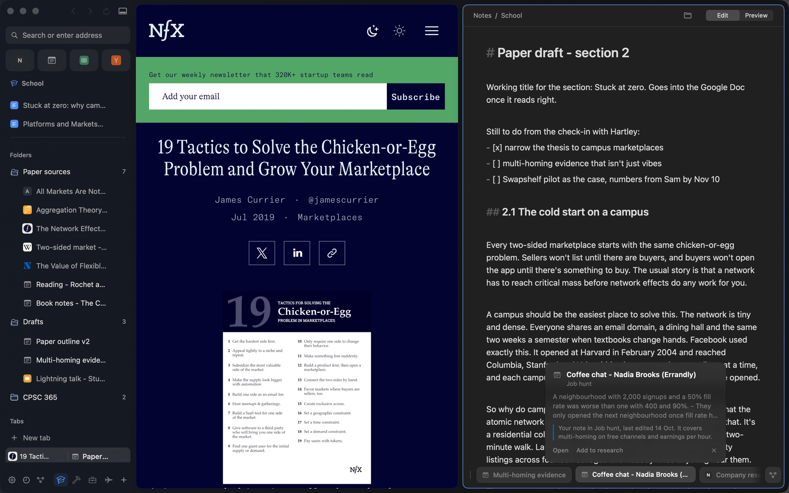
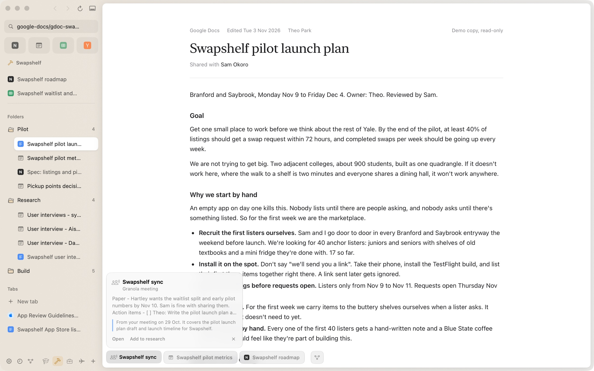
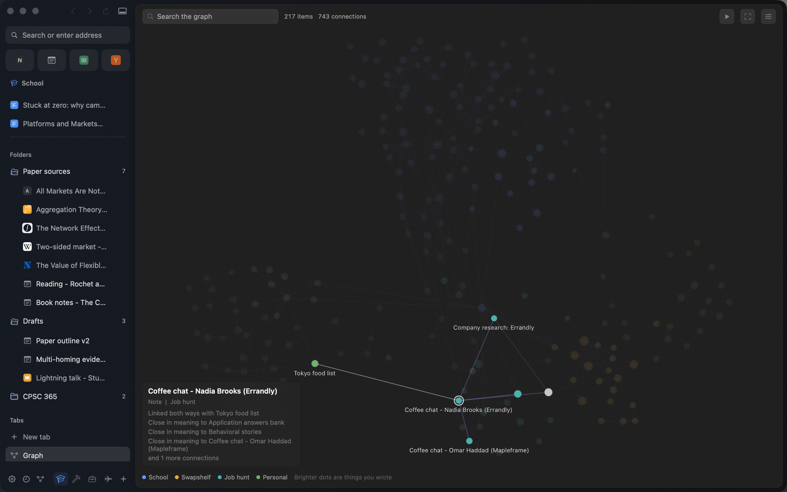
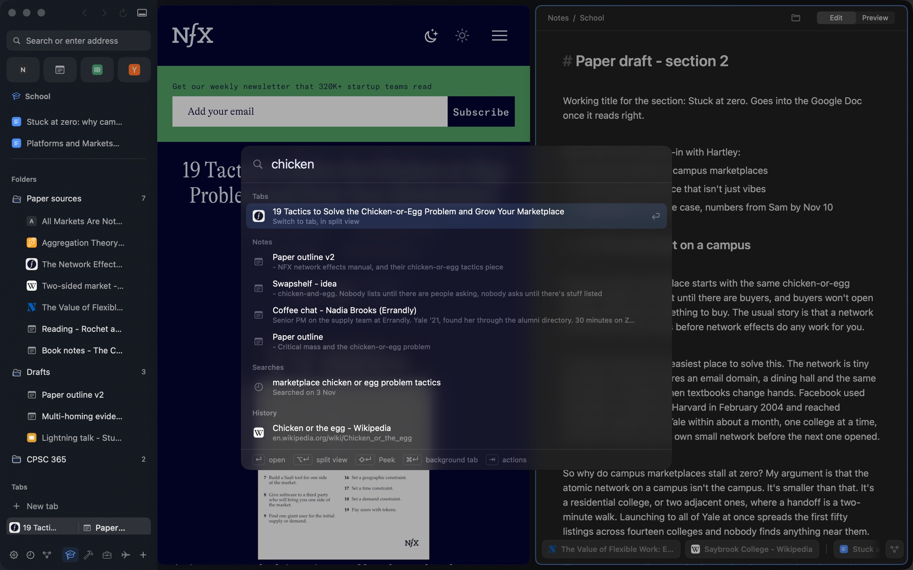
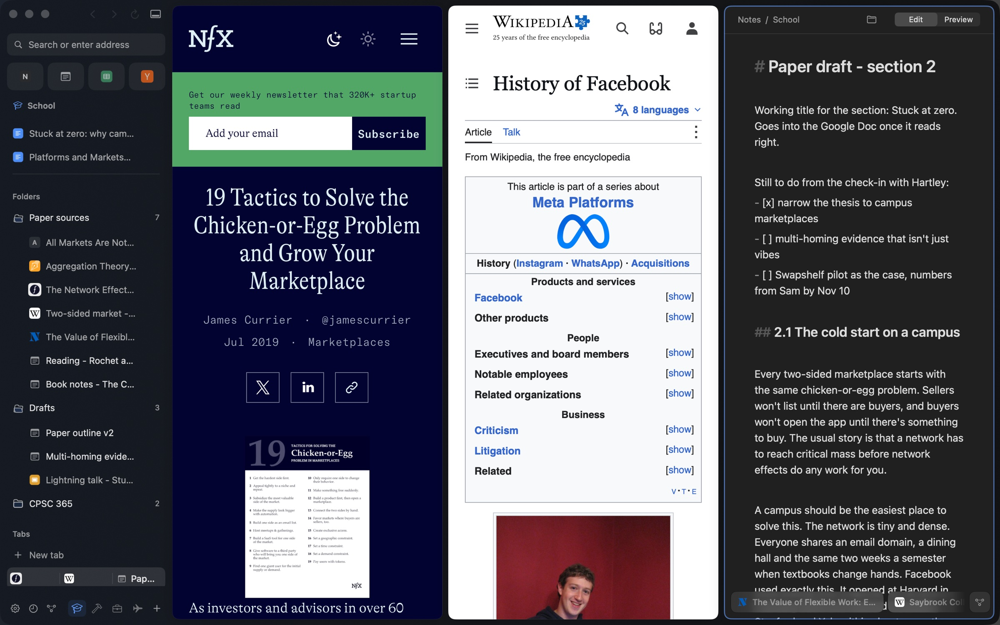
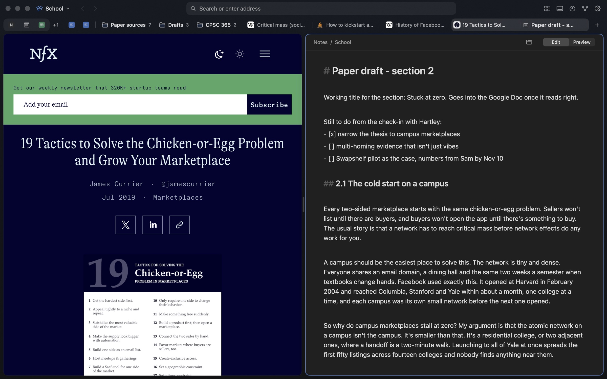
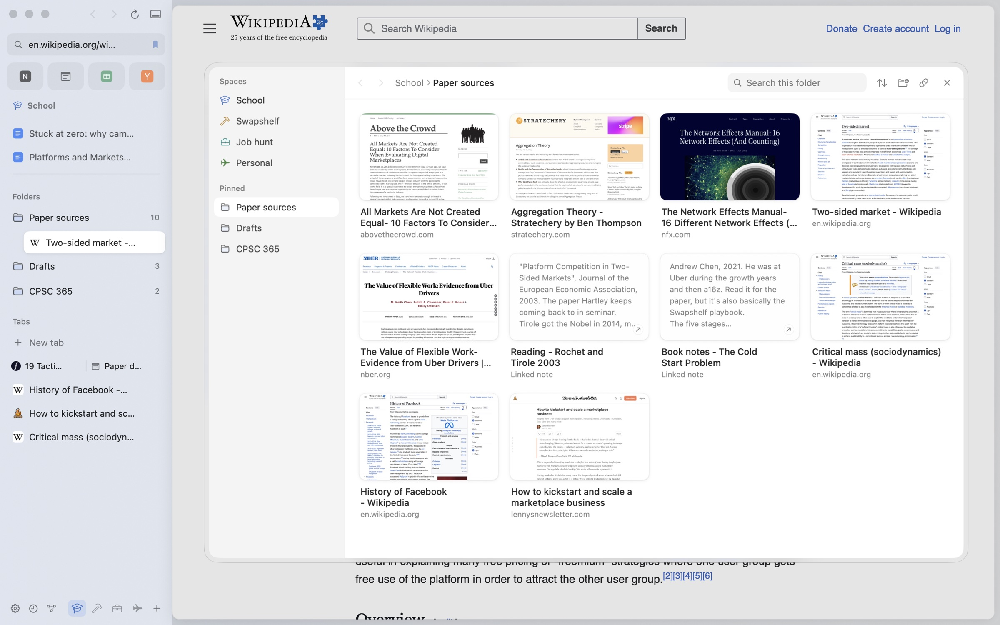
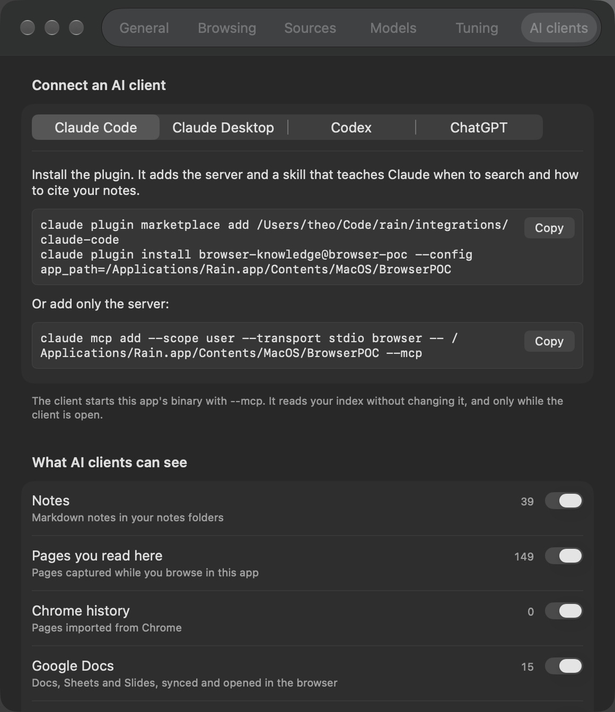

  

# Rain

Rain is a Mac browser I'm building, and this repo is its proof of concept.

Pages, notes, docs and meetings I've already seen come back on their own when what I'm working on makes them relevant. I don't have to file or pin anything first, and it all runs on my Mac.

## Why I'm building it

- Useful pages I've read disappear from my head. My history still has them, but that only helps if I remember they exist.
- My notes, Notion plans, Google Docs and meeting notes all hold pieces of the same work, and I'm the one who has to connect them again. That gets worse across projects, because the right note is usually sitting in a project I don't have open.
- I want Arc's way of organising tabs and Obsidian's local Markdown notes in the same place, so reading and writing happen side by side.

## What it does

### Related, at the bottom of the page

Whatever I'm reading or writing, Rain looks across everything I've seen and floats the few things that actually relate along the bottom of the page as small cards. Hovering one shows the passage that matched and why it came back, like "Your note in Job hunt, last edited 14 Oct". It looks across every space, so a coffee chat from my job hunt can come back while I'm writing a paper. When nothing clears the bar, there's no row at all.

Picking the cards runs on the Mac. EmbeddingGemma finds candidates by meaning alongside keyword and name search, a Qwen3 reranker reads each one against the part of the page it matched, and Apple's on-device model judges the close calls and writes the reasons. The first launch downloads the two models, about 700 MB together.

### A graph of everything

An Obsidian-style graph connects my notes, Google Docs, Notion pages, Granola meetings and the sites I've read. Lines come from links in my notes, pages that led to other pages, things I opened side by side, things I added to research, closeness in meaning and shared topics. Each space gets its own colour, so the things that bridge two projects sit between them. It runs at 120 Hz on ProMotion, and the button at the end of the Related row opens a small graph around whatever I'm on.

### Arc and Zen, rebuilt natively

Spaces have their own pinned tabs, folders, tabs and splits, each with a colour that tints the sidebar, and a two-finger swipe slides between them under my fingers. Cmd-T opens one bar that switches tabs, runs about 40 commands, fills in addresses and searches my notes and history. Split view takes up to four pages or notes, and dragging a tab onto the page splits it, with a preview of the half it'll take. There's also Essentials, Peek, compact mode, auto-archive and pinned tabs that remember their page. The floating controls sit on Liquid Glass.

Tabs can run down the sidebar like Arc or along the top like Safari, and I can switch between the two any time. The sidebar drags narrower, all the way down to a single column of icons. Folders can hold folders, and dragging a tab onto a closed folder springs it open.

### Real folders for pages and notes

Every space has its own folder in `~/Documents/Rain`. Saving a page puts it in there as a file Finder and Safari can open, so my bookmarks and notes sit in the same folders. The folder popup is Rain's own file manager for them, with a picture of the top of every saved page and the first lines of every note. I pin the folders I use most to the sidebar and drag tabs in and out of them.

Notes are plain Markdown files. I point Rain at folders of them, like my Obsidian vault, and every note opens as a tab I can pin, file or split next to a page. The vault stays where it is, and a space's folder just links to it. Rain never re-saves a note on open and never overwrites a file that changed on disk, because Claude and Codex edit the same files.

### My AI can read it too

Rain runs as an MCP server, so Claude Code, Claude Desktop and Codex can search what I've read and written, see how things connect and know what I have open right now. That makes it a body of personal context that keeps itself up to date. A switch per source decides what AI clients can see, and editing notes stays off until I turn it on. The plugins are in [integrations/](integrations/).

Web pages, shared docs and meeting transcripts can be written by anyone, so they reach my AI wrapped in markers that say the text came from outside. Rain's instructions to the AI say to treat that text as information and never follow what it asks.

### Security and privacy

Rain runs on WebKit, the engine inside Safari, so it starts with Safari's tracking prevention and its warnings for phishing and malware sites. WebKit's security fixes reach Rain the same day they reach Safari, through macOS updates.

On top of that, Rain tries every site over HTTPS first, and a page that only loads over plain HTTP says Not secure in the address field. It sends Global Privacy Control, which tells sites not to sell or share my data. A page has to ask before it opens another app, so an ad or a redirect can't launch Zoom or the App Store on its own. Downloads get the same quarantine mark Safari gives them, so macOS checks a downloaded app before it first runs. Logins come from the Passwords app, the same iCloud Keychain Safari uses, and Rain never stores a password itself.

## About the screenshots

They come from a demo profile of a made-up student, Theo Park, who's writing a paper on campus marketplaces, building a textbook swap app, applying for PM internships and planning a trip to Japan. His notes, docs and meetings are made up, and the web pages are real.

The full feature list is in [docs/FEATURES.md](docs/FEATURES.md), and building it or opening the demo is in [DEVELOPING.md](DEVELOPING.md).

## Credits

A lot of how Rain handles tabs, spaces, split view and Cmd-T comes from [Arc](https://arc.net) and [Zen](https://github.com/zen-browser/desktop). Zen being open source meant I could read how those small behaviours actually work instead of guessing.
